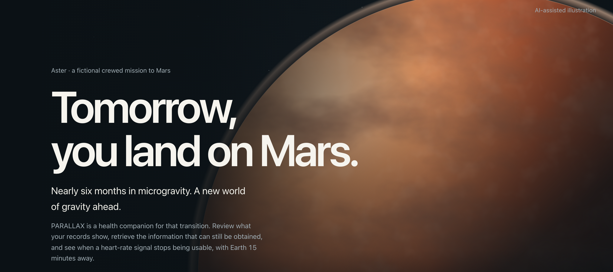
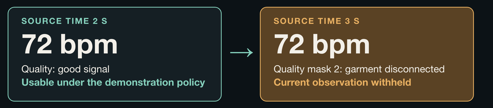

# PARALLAX: Astronaut Health Companion

**Tomorrow, you land on Mars.** What do your health records actually tell you, what is still missing, and what should you do next?

PARALLAX is an evidence-aware astronaut health companion. It turns scattered observations into understandable findings, trustworthy monitoring and clear next steps. It was built for the **2026 NASA Space Apps Challenge: _Create Health Monitoring Software for Astronauts on Space Missions_**.

> Having a measurement does not necessarily mean it answers the health question that matters.

**Live application:** [Open PARALLAX](https://parallax-health.brendanlimkh04.workers.dev/) · [Full guided demo](https://parallax-health.brendanlimkh04.workers.dev/?demo=full#mission/preflight) · [Short judging path](https://parallax-health.brendanlimkh04.workers.dev/?demo=short#mission/health)



*The Mars artwork is an original SI-assisted illustration, labelled in the app. All crew, mission and individual health data are fictional.*

## Short judging walkthrough

Open the [short judging path](https://parallax-health.brendanlimkh04.workers.dev/?demo=short#mission/health) in desktop Chrome or Edge. Use the guide's primary action; **Guide details** expands explanations and secondary controls.

1. Retrieve and validate the archived cycling follow-up. Inspect the supported **+15 bpm** change and **2/3 → 3/3 information coverage**, which does not measure readiness.
2. Designate fictional heart-rate monitoring and step the synthetic replay until the **72 bpm** reading becomes withheld because its quality mask reports disconnection.
3. Open the companion in a second tab in the same browser and acknowledge the actual signal event.
4. Save the fictional human review, inspect its findings, and download its matching HTML and JSON snapshots. Reload to inspect the saved review. No medical clearance is generated.

All actions use fictional data stored in this browser. No physical device is connected.

## What PARALLAX does

Follow Alex Morgan, a fictional astronaut on the Aster mission (DEMO-MARS-01), the day before a Mars landing:

1. **Preflight.** Personal Earth references: 1,000 N leg-press force, 3.0 L/min VO₂peak, 120 bpm at 100 W, 7.5 h sleep. Each keeps its acquisition context.
2. **Transit.** Compatible in-flight changes: VO₂peak 2.8 → 2.7 L/min, sleep 7.5 → 6.5 h, two cycling sessions at 100 W recording 125 and 140 bpm (the later one is in the onboard archive).
3. **Approach.** The review covers 2 of 3 named information items. PARALLAX names the missing exercise record, Alex retrieves and validates it, and the review shows **+15 bpm at the same workload** and **3/3 coverage**. This counts information, not readiness. Strength and post-landing mobility stay unresolved.
4. **Monitoring.** In a synthetic wearable replay, the raw heart rate stays at **72 bpm** while the quality mask reports a disconnection. PARALLAX **withholds** the reading, records an event, and a separate companion tab acknowledges it.
5. **Human review.** A fictional crew medical officer saves a review that does not change afterwards (HTML + JSON). No clearance is ever generated.
6. **Surface.** At 0.38 g, earlier physiology becomes historical, and the next assessment is planned.



## Key features

- **Acquisition-aware comparisons.** A difference appears only when the measurement identity and recorded conditions match.
- **Evidence-aware next steps.** Concrete actions: retrieve, inspect, designate, acknowledge.
- **Signal-quality-aware monitoring.** A documented-format parser aligns quality to each heart-rate sample.
- **Human-centred review.** Software organises the evidence, and a person decides. Both are preserved.
- **Local and offline.** No server, accounts or runtime AI. Works offline after successful production-cache installation; a first visit and external links require connectivity.
- **Research demonstration.** Uses Clément et al. (2024) published group means: matched −21.3 pp; a cross-condition +4.0 pp is withheld.

## Public source edition

Human contributor: **Brendan Lim** (sole human contributor, confirmed 16 November 2026). SI assistance is documented in [AI_DISCLOSURE.md](AI_DISCLOSURE.md).

This public snapshot replaces three agency photographs with original AI-generated equipment and habitat illustrations. It contains no agency photographs or recognizable people. The scientific citations remain because they explain the research basis; citing a resource does not imply endorsement.

The linked live competition application uses the accepted compact-guide release and its original imagery. **This repository is a public portfolio source edition, not a byte-identical copy of that deployed build.** Scientific calculations, fictional records, monitoring and review logic are preserved. [Source lineage and differences](docs/RELEASE_IDENTITY.md) records the exact boundary.

## Publication and development history

This repository starts with a new publication snapshot on 16 November 2026, derived from private development commit `9167a79b927ff62af5074128c3c9f7f256ba4371`. That source includes the accepted `phase10-e53055a-guide-hotfix.1` application based on `e53055a`.

The complete original Git history and original imagery are preserved in the private development archive. They are not imported here because old commits would expose the photographs that were removed from this public edition. This is an explicit publication boundary, not a claim that development began with this snapshot. The first development commit `9cdc28d` on 14 November 2026 consolidated earlier non-Git work; historical discrepancies remain recorded in [baseline provenance](docs/BASELINE.json). No original dates or commits were changed.

Original code remains Apache-2.0. The sole human contributor has requested public publication. This repository does not establish competition eligibility, original idea authorship or completed submission.

## Quick start

```sh
cd web
npm ci
npm run build
npm run preview      # http://127.0.0.1:4173
```

Node.js 24 is required. See [QUICKSTART.md](QUICKSTART.md) and [REPRODUCIBILITY.md](REPRODUCIBILITY.md).

## Architecture

A static TypeScript/React single-page app: observation register → acquisition-aware comparison engine → requirements and coverage → documented-format adapter → IndexedDB event ledger and BroadcastChannel companion → saved review snapshots → service worker. See [ARCHITECTURE.md](ARCHITECTURE.md).

## Science and NASA resources

PARALLAX's questions and boundaries come from the NASA Human Research Program (hazards, risks), the NASA Human-Systems Standards (4.0 Human Performance, 6.0 Medical Operations), the Human Research Roadmap sensorimotor gap SM-204, and NASA exercise and CEVIS resources. CSA Bio-Monitor provides wearable spaceflight context. See [SCIENTIFIC_FOUNDATION.md](SCIENTIFIC_FOUNDATION.md).

## Verification

The linked live application is **`phase10-e53055a-guide-hotfix.1`**, based on v0.10.0-alpha.10 / `e53055a`. Its historical source/input SHA-256 is `5bfa0be0fcbd1dfc681d7e8b0883032ccf2c5b78e10fc2f1e966681940f03718`.

The base candidate passed **511 unit/scenario tests and 211 Chromium workflows**, with zero skipped, flaky or unexpected results. The compact-guide hotfix changed only `MissionGuide.tsx` and `guide.css` and passed **36 relevant unit tests, 8 existing browser regressions, full and short journeys, 10 guide regression groups, and an installed-offline short journey**. The full 511/211 suite was **not rerun on the hotfix**. Publication checks independently matched **all 42 live asset hashes** to the accepted hotfix package and found no expanded-guide axe violations or console/page errors.

**Public source edition:** verification performed on this edition is recorded in [PUBLIC_EDITION_VERIFICATION.md](PUBLIC_EDITION_VERIFICATION.md). The historical counts above are not a new pass on this changed source.

These are automated software checks, not clinical or human-usability validation (**human evaluation N = 0**). [Candidate binding and verification scope](docs/RELEASE_IDENTITY.md) explains the separate application and publication identities.

## Data provenance and limitations

Every individual record is fictional, and no astronaut medical data is used. PARALLAX does not diagnose, prescribe, triage, or decide landing or EVA readiness. It does not connect to physical hardware and does not implement an official CEVIS protocol. See [DATA_PROVENANCE.md](DATA_PROVENANCE.md) and [LIMITATIONS.md](LIMITATIONS.md).

## Attribution, licence and SI disclosure

Original code: Apache-2.0 ([LICENSE](LICENSE)). Publications and agency marks keep their own rights; no agency photographs are bundled in this edition. See [ATTRIBUTION.md](ATTRIBUTION.md) and [LICENSE_REVIEW.md](LICENSE_REVIEW.md). Not affiliated with or endorsed by NASA, CSA or Hexoskin.

PARALLAX was built with substantial SI assistance (ChatGPT, OpenAI Codex, Claude Code). See [AI_DISCLOSURE.md](AI_DISCLOSURE.md).
